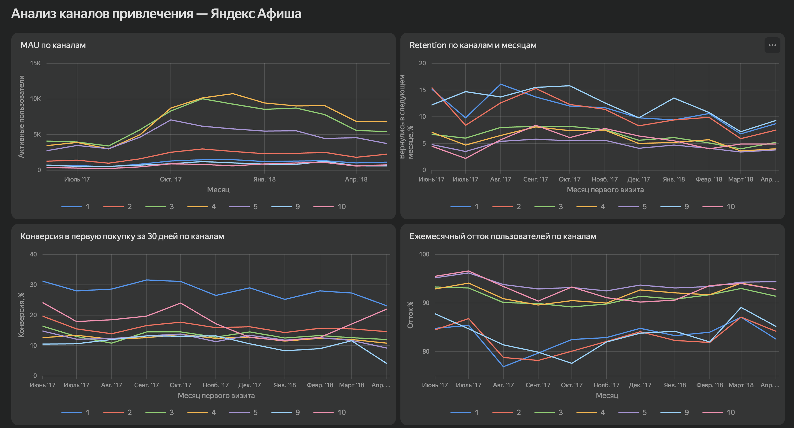
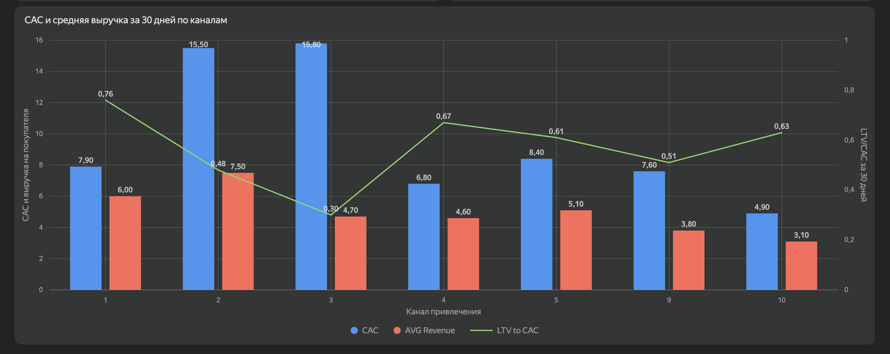

# Яндекс Афиша: сравнение рекламных каналов

Анализ рекламных каналов Яндекс Афиши по данным за июнь 2017 – май 2018: визиты, заказы и рекламные расходы.

**Стек:** SQL (PostgreSQL), DBeaver, Yandex DataLens

**Вопрос проекта:** как перераспределить рекламный бюджет между каналами, чтобы с каждой потраченной единицы возвращалось больше выручки?

[Дашборд в DataLens](https://datalens.yandex/hw5ytn87dtb40?_share_link=public) · [SQL-запросы](Analysis.sql)

## Главное

- **Ни один канал не окупается за первые 30 дней.** Выручка на единицу расходов: от 0,30 (канал 3) до 0,76 (канал 1), в среднем по всем каналам 0,48. Выручка считается без себестоимости, так что прибыль ещё ниже.
- **Канал 3 — главная проблема.** На него приходится 43% бюджета, а отдача у него самая низкая (0,30). Стоимость покупателя здесь выросла с 11,5 в июне 2017 до 19,1 в апреле 2018.
- **Канал 1 лучший по экономике** (0,76) и по конверсии: первое место во всех 11 месяцах. Но ему достаётся 6% бюджета, а аудитория небольшая (до 1,5 тыс. MAU), поэтому быстро нарастить объём вряд ли получится.
- **Канал 4 подходит как основной получатель дополнительного бюджета.** Он крупный (до 10,7 тыс. MAU), отдача 0,67, а стоимость покупателя за год почти не изменилась (8,1 в июне 2017, 7,7 в апреле 2018).

## Исходные данные

Исходные выгрузки Яндекса собраны в [папке `data`](data/).

| Файл CSV | Строк | Что содержит |
|---|---|---|
| [`visits_log.csv`](data/visits_log.csv) | 359 400 | визиты: пользователь, канал, начало и конец сессии, устройство |
| [`orders_log.csv`](data/orders_log.csv) | 50 415 | заказы: пользователь, время, выручка |
| [`costs.csv`](data/costs.csv) | 2 542 | рекламные расходы по дням и каналам |

Каналы 6 и 7 исключены из анализа: за весь период у них 1 и 9 уникальных пользователей по максимуму в месяц, а данных о расходах по ним нет.

## Как считались метрики

Пользователь относится к каналу своего первого визита. «Первый» значит первый в выгрузке: что было до июня 2017, неизвестно.

| Метрика | Определение |
|---|---|
| MAU, DAU | уникальные пользователи за месяц и за день |
| Retention | доля пришедших впервые в месяце, кто вернулся в следующем |
| Churn | доля всех активных в месяце (новых и прежних), кто не пришёл в следующем |
| Конверсия | доля новых пользователей, купивших не позже чем через 30 дней после первого визита |
| CAC | расходы канала за месяц ÷ число покупателей из пришедших в этом месяце |
| LTV 30 | выручка за 30 дней с момента первой покупки (включая её) ÷ число покупателей |
| LTV/CAC | выручка на единицу расходов: LTV 30 ÷ CAC |

Покупатели в CAC и в LTV одни и те же: те, кто сделал первую покупку в течение 30 дней после первого визита.

**Май 2018** исключён из retention, churn, конверсии, CAC и LTV: в данных нет июня, а у пришедших в мае не набирается полных 30 дней. **DAU** посчитан в SQL, но на дашборд не вынесен: масштаб каналов показывает MAU.

## Результаты

### Аудитория, удержание, конверсия

*Каналы 6 и 7 на графиках не показаны (мало пользователей, нет данных о расходах). Май 2018 не показан на графиках retention, churn и конверсии: для него не хватает данных. Churn считается по всей активной аудитории месяца, включая пришедших раньше. Это общая характеристика стабильности аудитории канала, а не эффект рекламы, поэтому для решения по бюджету основными остаются retention, конверсия, CAC и LTV.*

**Масштаб.** Основную аудиторию дают каналы 3, 4 и 5. С июня по сентябрь самым крупным был канал 3, с октября — канал 4 (пик 10 742 пользователя в декабре 2017). К весне 2018 аудитория всех крупных каналов сократилась. Одного года данных недостаточно, чтобы отделить сезонность от роста.

**Качество аудитории.** Каналы делятся на две группы:

- **Каналы 1, 2 и 9** меньше по масштабу, но их пользователи возвращаются: они входили в тройку лидеров по удержанию во всех 11 когортах и в тройку с самым низким оттоком. В следующем месяце они возвращаются примерно вдвое чаще, чем пользователи каналов 3, 4, 5 и 10.
- **Каналы 3, 4 и 5** дают большую аудиторию, но возвращается лишь около 5–6% новичков.

Отток высокий у всех каналов (от 76,9% до 96,6% за месяц). Для сервиса, где билеты покупают нечасто, это согласуется с общей картиной.

**Конверсия.** Канал 1 лидирует в каждом из 11 месяцев: от 23,1% до 31,6% новых пользователей покупают в первые 30 дней. У канала 9, лучшего по удержанию, конверсия низкая (4,1–13,2%): пользователи возвращаются, но редко покупают.

### Стоимость покупателя и выручка

*Когорты первого визита июнь 2017 – апрель 2018, май исключён. Расходы и покупатели суммируются за весь период. Выручка и расходы предположительно измеряются в одних единицах (в выгрузке единицы не указаны). У части апрельских покупателей (около 4%) 30-дневное окно выручки выходит за границу выгрузки, влияние на итог небольшое. Каналов 6 и 7 нет: по ним не посчитать CAC.*

Доля каждого канала в рекламном бюджете (июнь 2017 – апрель 2018, по таблице `costs`) рядом с отдачей:

| Канал | Доля бюджета | Выручка на единицу расходов |
|---|---|---|
| 1 | 6,3% | 0,76 |
| 4 | 18,5% | 0,67 |
| 10 | 1,8% | 0,63 |
| 5 | 15,7% | 0,61 |
| 9 | 1,7% | 0,51 |
| 2 | 13,1% | 0,48 |
| 3 | 43,0% | 0,30 |

Именно это сопоставление показывает, где бюджет работает хуже всего:

- **Канал 3.** Почти половина бюджета уходит в канал с самым дорогим покупателем (CAC 15,8) и самой низкой отдачей. Стоимость покупателя колеблется от месяца к месяцу, но тенденция вверх: 11,5 в июне 2017, 19,1 в апреле 2018.
- **Канал 2.** Больше всех выручки с одного покупателя (7,5), но CAC в два раза и больше выше, чем у каналов 1 и 4. На 13% бюджета возвращается 0,48.
- **Каналы 9 и 10.** Покупатели дешёвые (CAC 7,6 и 4,9), но приносят мало (3,8 и 3,1), а доля бюджета меньше 2%: масштаба у них нет. В апреле у канала 9 CAC подскочил до 31 (конверсия 4,1%, 12 покупателей). Это выброс на малой выборке.

## Рекомендации

1. **Проверить сокращение бюджета канала 3.** Здесь самая большая отдача от изменения: 43% бюджета при возврате 0,30. Если бы расходы канала 3 возвращали столько же, сколько канал 4 (0,67), отдача была бы больше чем вдвое выше. Это потолок, а не прогноз: с ростом бюджета возврат канала обычно падает.
2. **Направлять освободившийся бюджет в каналы 4 и 1, ступенями.** Канал 4 может принять больший объём, его CAC за год заметно не вырос (колеблется в пределах 5–10). Канал 1 эффективнее, но маленький, а его CAC за год вырос с 5,7 до 8,3, поэтому шаги нужны небольшие.
3. **Разобраться с каналом 2.** Удержание на уровне канала 1, но покупатель обходится вдвое дороже. Причину стоит понять до решения о бюджете.
4. **Метрики теста:** выручка за 30 дней на единицу расходов (по каналам и в сумме) и CAC каналов-получателей. Если CAC растёт быстрее, чем выручка на покупателя, шаг останавливается.
5. **До изменения бюджета** посчитать LTV на горизонте 60–90 дней и узнать маржу. При возврате 0,48 за 30 дней неизвестно, окупаются ли каналы на самом деле.

## Ограничения

- Горизонт LTV 30 дней: окупаемость на длинном сроке не видна.
- Выручка, а не прибыль.
- Атрибуция по первому визиту: последующие визиты из других каналов не учитываются.
- Один год данных: сезонность и рост не разделить.
- Анализ показывает различия между каналами, но не их причины и не то, как изменится эффективность при другом бюджете.
- Расходы относятся к месяцу первого визита покупателей, а не к месяцу покупки.

## Как воспроизвести

1. Загрузить три CSV из папки `data` в PostgreSQL в таблицы `visits_log`, `orders_log`, `costs` с теми же названиями столбцов.
2. Выполнить запросы из `Analysis.sql` по порядку.

## Автор

[sonyamuttmi](https://github.com/sonyamuttmi)
